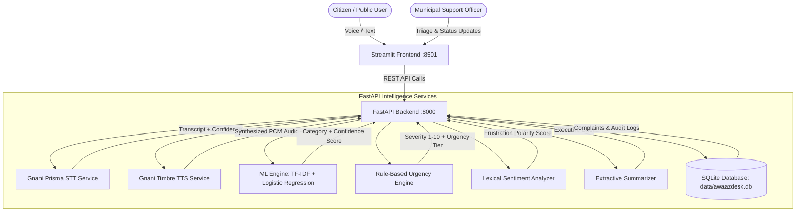

# AwaazDesk – AI Voice Grievance Intelligence System 🎙️

An AI-powered voice and text grievance dispute resolution platform for citizen public utilities and civic governance in **Hindi**, **English**, and **Hinglish**.

---

## 📌 Objective & Core Highlights

- **Multilingual Citizen Ingestion**: Citizens submit grievances via voice audio or typed text in **हिन्दी (Hindi)**, **English**, or **Hinglish** (code-mixed).
- **Dedicated Gnani.ai Integrations**:
  - **Gnani Prisma STT (Speech-to-Text)**: High-accuracy ASR across Indian dialects (`hi-IN`, `en-IN`, `hi-en`).
  - **Gnani Timbre TTS (Text-to-Speech)**: Audio synthesized confirmation and dispute status readout.
  - **Gnani Evon v3.3 Indic LLM (Artha Sovereign Stack)**: Sovereign Indic reasoning, intent understanding, and officer action recommendations.
  - *Strict Transparency Policy*: If live credentials are not configured, AwaazDesk runs in a clearly-labelled **Integration Placeholder Mode** with simulated transcripts and audio chimes, never faking API requests.
- **Clear AI/ML Distinction**:
  - 🤖 **Category Classification**: High-accuracy Scikit-Learn Machine Learning pipeline (`TF-IDF + Logistic Regression`, **85%+ empirical test accuracy**) with confidence percentage across 8 civic classes.
  - ⚖️ **Urgency & Severity Detection**: Multi-factor Rule-Based Heuristic Engine (Critical / High / Medium / Low) with danger and safety triggers.
  - 🧠 **Sentiment Analysis**: Lexical Polarity and Citizen Frustration Engine.
  - 📝 **Executive Summary**: Extractive Rule-Based Salience Sentence Summarizer.
- **Persistent SQLite Storage**: Relational complaint records, unique ticket IDs (`AWA-2026-XXXX`), and granular timeline audit trail.
- **Admin & Support Dashboard**: Multi-parameter grievance triage, status lifecycle updates (`Open` -> `In Progress` -> `Resolved`), department reassignments, and interactive **Plotly** analytics.
- **Accessible Responsive UI**: Custom high-contrast styling and visual distinction tags.

---

## 🏛️ System Architecture



---

## 🛠️ Technology Stack

| Layer | Technologies |
| :--- | :--- |
| **Frontend** | Streamlit, Custom Accessible CSS, HTML5 Audio Player |
| **Visualizations** | Plotly Express & Plotly Graph Objects |
| **Backend API** | FastAPI, Uvicorn, Pydantic v2 |
| **Database** | SQLite 3 (`data/awaazdesk.db`) |
| **Machine Learning** | Scikit-learn (`TfidfVectorizer` + `LogisticRegression`), Joblib |
| **Speech & Indic AI** | Gnani.ai Prisma STT, Gnani.ai Timbre TTS, Gnani.ai Evon v3.3 (Artha Stack) |
| **Language Support** | Hindi (`hi`), English (`en`), Hinglish code-mixed (`hinglish`) |
| **Testing** | Pytest, Requests |

---

## 🚀 Quickstart & Setup Guide

### 1. Prerequisites
- Python 3.10+ (tested on Python 3.14)
- Git

### 2. Clone Repository & Install Dependencies
```bash
cd AwaazDesk
pip install -r requirements.txt
```

### 3. Environment Configuration
Copy the template `.env.example` into `.env`:
```bash
cp .env.example .env
```

Edit `.env` to configure your settings:
```ini
BACKEND_HOST=127.0.0.1
BACKEND_PORT=8000
FRONTEND_PORT=8501
SQLITE_DB_PATH=data/awaazdesk.db

# Gnani.ai official API credentials (api.vachana.ai)
# Option A: One shared API key for STT, TTS, and Evon:
GNANI_API_KEY=your_gnani_api_key_here

# Option B: Per-service configuration:
GNANI_PRISMA_API_KEY=
GNANI_PRISMA_ENDPOINT=https://api.vachana.ai/stt/v3

GNANI_TIMBRE_API_KEY=
GNANI_TIMBRE_ENDPOINT=https://api.vachana.ai/api/v1/tts/inference

GNANI_EVON_API_KEY=
GNANI_EVON_ENDPOINT=https://api.vachana.ai/v1/chat/completions
GNANI_EVON_MODEL=gnani-evon-v3.3

API_BASE_URL=http://127.0.0.1:8000
```

---

## 🏃 Running the Application

### Option A: Launch Both Servers Concurrently (Recommended)
Run the built-in orchestrator:
```bash
python run_servers.py
```
- **Streamlit Frontend**: [http://127.0.0.1:8501](http://127.0.0.1:8501)
- **FastAPI Backend**: [http://127.0.0.1:8000](http://127.0.0.1:8000)
- **Interactive Swagger Docs**: [http://127.0.0.1:8000/docs](http://127.0.0.1:8000/docs)

### Option B: Run Servers Independently
**Terminal 1 (FastAPI Backend)**:
```bash
python -m uvicorn backend.main:app --host 127.0.0.1 --port 8000 --reload
```

**Terminal 2 (Streamlit Frontend)**:
```bash
python -m streamlit run frontend/app.py --server.port 8501
```

---

## 🧪 Running Automated Tests

Run the full test suite verifying ML classification, urgency scoring, sentiment analysis, summarization, Gnani placeholders, and API endpoints:
```bash
pytest backend/tests -v
```

---

## 📑 API Reference

| Endpoint | Method | Description |
| :--- | :---: | :--- |
| `/api/health` | `GET` | Subsystem health, ML ready state, and Gnani API status |
| `/api/complaints/preview` | `POST` | Instant ML categorization, urgency, sentiment & summary |
| `/api/complaints` | `POST` | Submit complaint, classify, generate ticket ID (`AWA-2026-XXXX`) |
| `/api/complaints` | `GET` | List complaints with category, status, urgency & text filters |
| `/api/complaints/{ticket_id}` | `GET` | Retrieve full complaint details and audit timeline |
| `/api/complaints/{ticket_id}` | `PATCH` | Update status, assigned department, and resolution notes |
| `/api/voice/transcribe` | `POST` | Dedicated Gnani Prisma STT audio transcription |
| `/api/voice/synthesize` | `POST` | Dedicated Gnani Timbre TTS voice synthesis |
| `/api/evon/analyze` | `POST` | Dedicated Gnani Evon v3.3 sovereign Indic reasoning & officer recommendations |
| `/api/analytics` | `GET` | Aggregated metrics and distributions for Plotly visualizations |
| `/api/ml/retrain` | `POST` | Trigger Scikit-learn model retraining with latest DB tickets |

---

## 🛡️ License & Ethics

Designed and built for transparent, accountable civic dispute resolution. Respects citizen privacy and strictly preserves separation between statistical Machine Learning models and heuristic rule engines.
